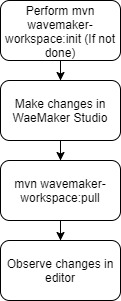
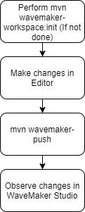
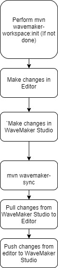
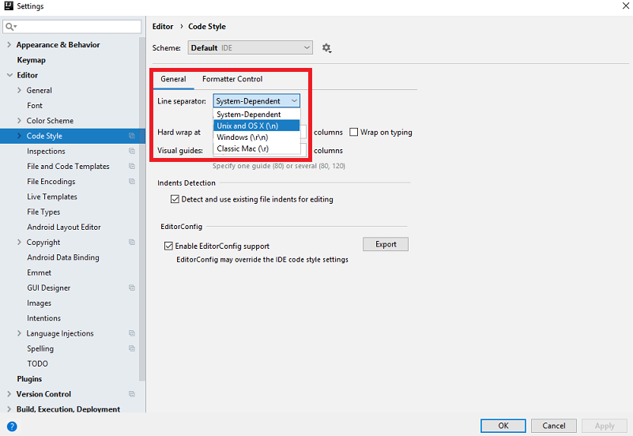
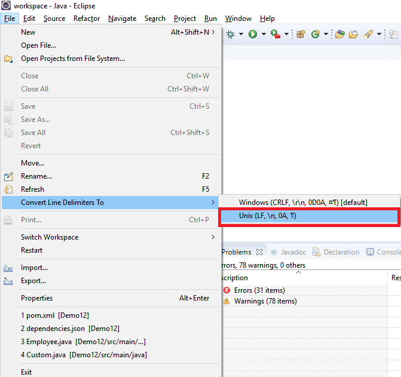

---

In scenarios where you want to work on WaveMaker apps and use IDE for editing Java code, synchronizing the two can be a challenge.

In this post, we will introduce a Maven plugin - wavemaker-workspace Plugin, which updates project changes between WaveMaker and IDE on your local machine. 

## WaveMaker WorkSpace Sync Plugin

When working on a project using an IDE, earlier you had to export the project from WaveMaker, import into IDE, make changes, build and re-import the project into WaveMaker ([see here for details](/learn/app-development/dev-integration/extending-application-using-ides/)). This was a time-taking and tedious process.

**WaveMaker WorkSpace Sync Plugin** provides a communication channel between the IDE and Studio Workspace. You can directly push the changes made to the project from IDE to Studio Workspace without any overhead of copying and pasting the code. It solves the problem of synchronization between IDE and Studio Workspace without re-exporting the project. It also helps in getting the latest changes from Studio Workspace to IDE directly.

## Prerequisites

- Git has to be installed on your local machine.
- An access token for the project you want to sync. An **access token** is a key generated in WaveMaker Studio that lets the Sync Plugin connect to your project without your WaveMaker password or browser session. It is valid for the period you choose (1–90 days). After it expires, generate a new token and enter it when the plugin prompts you. To generate one:
    1. Open the project in WaveMaker Studio.
    2. Go to **Project Settings** > **Access Tokens** > **Generate New Token**.
    3. Choose a validity period (1–90 days) and copy the token value. You will need it when you run the `init` command.

:::note
The access token is restricted to the project it was created for and to the Sync Plugin operations. It cannot be used to access other projects. If you work on more than one project, generate a separate token for each project.
:::

## How to use this plugin

**Initialize the plugin**: This is a one-time setup configuration. 

1. Export *any* WaveMaker project by opening the project options in project listing page or by clicking on the export button in the top navbar if you are inside the project.

2. After downloading the exported project zip, extract it into a folder. You can use your IDE to import this folder as a Java project.

:::note
In the below step, all changes made to the project in IDE will be replaced with the Studio source.
:::

3. Either from the terminal of your IDE or from the command shell on your local machine run the following command in the project folder:
```    
mvn wavemaker-workspace:init
```    
4. Upon running the above Maven command, you will be prompted to enter:
    - the Studio **hostUrl**
5. Next, enter the **Access Token** generated from **Project Settings** > **Access Tokens** when prompted. Because the plugin does not depend on your browser session, it also works for SSO users, and logging out of Studio does not affect it.

[](/learn/assets/InitFlowAccessToken.jpg)

6. Once the token is validated, the plugin shows the project name and branch linked to the token. Confirm to continue fetching the project.
7. `Build Success` message will indicate that the project is now available for use from your IDE.

## How to synchronize your project

There are three scenarios wherein you will be dealing with once you start using the IDE.

:::note
The `pull`, `push`, and `sync` commands reuse the access token saved during `init`. You will be prompted for a new access token only when the saved token has expired or been revoked.
:::

### Pull

This command can be used to pull the latest changes made to project in Studio are applied to IDE code. This includes both the latest commits made in Studio and uncommitted changes. 

:::important
If the same file is modified in both IDE and Studio Workspace, a **merge conflict** occurs and the process terminates. You have to resolve the conflicted files and rerun the command to pull changes from Workspace.
:::

```    
mvn wavemaker-workspace:pull
```

[](/learn/assets/PullChangesFlow.jpg)
    
### Push

All the IDE changes are pushed to Studio Workspace. If the same file is modified in both IDE and Studio Workspace, a **merge conflict** occurs and the process terminates. You have to resolve the conflicted files and rerun the command to push IDE changes to Workspace.

```
mvn wavemaker-workspace:push
```

[](/learn/assets/PushChangesFlow.jpg)

### Sync

This command works in two steps:

- **Pull latest changes from Studio WorkSpace**: In this step, you will be prompted to pull the latest changes from Studio Workspace. The latest changes made to project in Studio are applied to IDE code. This includes both the latest commits made in Studio and uncommitted changes. This makes sure that both IDE and Studio are in the same state. 


- **Push IDE changes to Studio Workspace**: If there are no conflicts in step 1, all the IDE changes are pushed to Studio Workspace.

```
mvn wavemaker-workspace:sync
```

[](/learn/assets/SyncChangesFlow.jpg)


## Limitations

1. Creation of pages and services (except Java Service) need to be done from WaveMaker platform. Use IDE for editing purposes only.
2. There is no provision to make new commits to VCS from IDE. All changes have to be committed from Studio Workspace.
3. Binary files cannot be pulled or pushed.

## Troubleshoot

- In case there are any major issues with the code in the IDE, like unresolvable conflicts, it is recommended to run the init command again.

``` 
mvn wavemaker-workspace:init
```

:::warning
However, by using the `init` command, the IDE changes will be lost. 
:::


## Prerequisites for Windows

If you are using any IDE or programming editor of your choice, make sure to change the line separator or delimiter to Unix (\n). **For example:** **In intellij IDEA :-** From the code Style panel, set the Line Separator field property from system-dependent to unix-style.

[](/learn/assets/IntelliJLineSeparator.png)

### In Eclipse

User has to select the project and convert line delimiters to Unix.

[](/learn/assets/EclipseIDELineSeparator.png)
